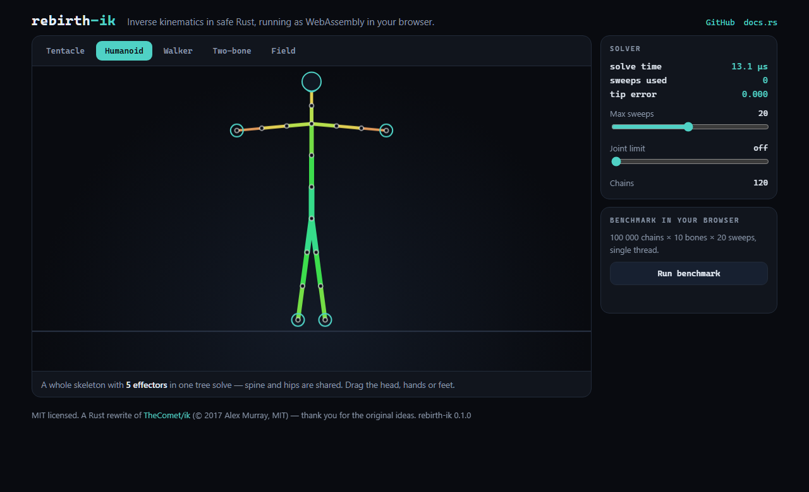
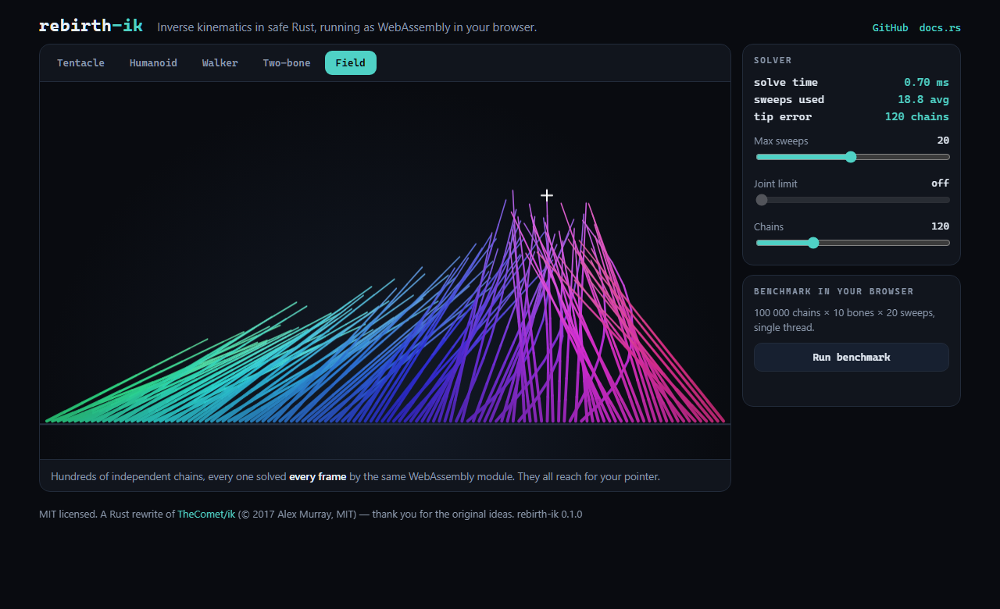

# rebirth-ik

**Inverse kinematics in safe Rust.** FABRIK for whole bone *trees*, closed-form one/two-bone solvers, joint limits, `no_std`, and a WebAssembly build you can play with right now.

[](https://github.com/markankamaransheogarat-sys/rebirth-ik/actions/workflows/ci.yml)
[](https://crates.io/crates/rebirth-ik)
[](https://docs.rs/rebirth-ik)
[](LICENSE)
[](#no_std-and-embedded)
[](crates/rebirth-ik/src/lib.rs)

### ▶ [**Live demo**](https://markankamaransheogarat-sys.github.io/rebirth-ik/) — a tentacle, a humanoid with 5 effectors, a procedural walker, an analytic knee, and 400 chains solved every frame, all running as WebAssembly.

<p align="center">
  
  
</p>

## Why "rebirth"?

This crate is a from-scratch Rust rewrite of [**TheComet/ik**](https://github.com/TheComet/ik) — a C library by **Alex Murray**, MIT licensed, last touched in 2018. The original had some genuinely good ideas, most of all how it turns an arbitrary bone tree plus a few effectors into a forest of *chains* that can be solved independently and stitched back together. It also never got finished: its FABRIK unit test is a stub (`ASSERT_TRUE(0)`), the multi-segment solver is empty, the hinge/cone constraints do nothing, and the convergence check is inverted.

`rebirth-ik` keeps the ideas, credits the author, and finishes the job in safe Rust:

* the chain decomposition is ported faithfully — the scenarios from the original's (commented-out) test-suite run as real tests here;
* FABRIK is implemented end to end for trees with any number of effectors;
* constraints actually constrain; the analytic solvers handle the degenerate cases instead of dividing by zero.

Thank you, Alex. The MIT license of the original is preserved in [`LICENSE`](LICENSE).

## Features

| | |
|---|---|
| **FABRIK on bone trees** | Any number of effectors, shared sub-bases, effectors in the middle of a chain, per-effector `chain_length`, `weight` (with optional NLERP blending), early exit with tolerance. |
| **Joint rotations** | Optional reconstruction of local rotations from the solved positions (with quaternion averaging where chains meet). |
| **Constraints** | `Cone`, `Hinge` (around a world axis, with min/max) and `Stiff`, enforced in the backward pass so the solved pose always respects them. |
| **Analytic solvers** | `one_bone` and `two_bone` (law of cosines) with a **pole vector** for knees/elbows; no NaN on collinear input. |
| **Zero-allocation chain solver** | `solve_chain(&mut [Vec3], &[f32], target, …)` — no skeleton, no heap, `no_std`. The hot path for ropes, tentacles, crowds. |
| **Parallel batches** | `solve_chains_par` (feature `rayon`) for thousands of independent chains. |
| **`#![forbid(unsafe_code)]`** | No `unsafe` anywhere in the core. |
| **`no_std`** | Builds for bare-metal targets (CI builds `thumbv7em-none-eabihf`) with the `libm` feature. |
| **WebAssembly** | Ready-made `wasm-bindgen` bindings and the demo in [`web/`](web). |

## Quick start

```toml
[dependencies]
rebirth-ik = "0.1"
```

### A skeleton with effectors

```rust
use rebirth_ik::*;

// a three-bone arm
let mut skel = Skeleton::new();
let root = skel.add_root(Vec3::ZERO);
let a = skel.add_child(root, Vec3::new(0.0, 1.0, 0.0));
let b = skel.add_child(a, Vec3::new(0.0, 1.0, 0.0));
let hand = skel.add_child(b, Vec3::new(0.0, 1.0, 0.0));

// where should the hand go? (chain_length 0 = all the way to the root)
skel.set_effector(hand, Effector::new(Vec3::new(1.5, 1.5, 0.0)));

let mut solver = Fabrik::new(&skel, Config::default());
let info = solver.solve(&mut skel);        // writes solved *local* transforms back
assert!(info.converged);
println!("hand is at {:?}", skel.global_position(hand));
```

Call `solver.rebuild(&skel)` whenever you add or remove effectors or change a `chain_length`; moving targets needs no rebuild.

### Several effectors on one tree

```rust
// `skel`, `head`, `l_hand`, `r_hand` come from your own skeleton
skel.set_effector(head,   Effector::new(Vec3::new(0.0, 1.8, 0.2)));
skel.set_effector(l_hand, Effector::new(Vec3::new(-0.6, 1.2, 0.5)).with_chain_length(3)); // shoulder → hand
skel.set_effector(r_hand, Effector::new(Vec3::new(0.6, 1.2, 0.5)).with_weight(0.5));       // half-blended
```

### Joint limits and rotations

```rust
// bend the knee only about the X axis, from straight (0) to 2.4 rad
skel.set_constraint(knee, Constraint::Hinge { axis: Vec3::X, min: 0.0, max: 2.4 });
let cfg = Config { constraints: true, joint_rotations: true, ..Config::default() };
```

### One chain, no allocation

```rust
use rebirth_ik::{segment_lengths, solve_chain, Vec3};

let mut points: Vec<Vec3> = (0..11).map(|i| Vec3::new(0.0, i as f32, 0.0)).collect();
let mut lengths = [0.0; 10];
segment_lengths(&points, &mut lengths);

let r = solve_chain(&mut points, &lengths, Vec3::new(4.0, 5.0, 1.0), 20, 1e-3);
assert!(r.error < 1e-2);
```

### Two bones with a knee

```rust
use rebirth_ik::{two_bone, Vec3};

let (hip, knee, foot) = (Vec3::ZERO, Vec3::new(0.0, -1.0, 0.0), Vec3::new(0.0, -2.0, 0.0));
let (new_knee, new_foot) = two_bone(hip, knee, foot, Vec3::new(0.3, -1.6, 0.0), Some(Vec3::new(0.0, 0.0, 5.0)));
```

## Performance

Measured with [Criterion](crates/rebirth-ik/benches/solve.rs) on an Intel i5-12400F (6 cores / 12 threads), Rust 1.99, `--release` with `lto = "fat"`, `f32`. Every case runs a fixed 20 sweeps (no early exit), so the numbers are the full cost of a solve.

| Scenario | Time |
|---|---:|
| Single chain, 5 bones | 0.90 µs |
| Single chain, 10 bones | 3.7 µs |
| Single chain, 20 bones | 9.0 µs |
| Single chain, 50 bones | 23 µs |
| Single chain, 200 bones | 94 µs |
| Humanoid tree, 5 effectors (positions only) | 7.3 µs |
| Humanoid tree, 5 effectors (with joint rotations) | 7.6 µs |
| Two-bone analytic | 11.7 ns |
| **Crowd of 100 000 ten-bone chains**, one thread | 376 ms (0.27 M chains/s) |
| **Crowd of 100 000 ten-bone chains**, `rayon`, 12 threads | **39 ms (2.5 M chains/s)** — ×9.6 |
| Same crowd in **WebAssembly** (Chrome, one thread) | ≈ 410 ms (0.24 M chains/s) — within ~15 % of native |

Reproduce: `cargo bench -p rebirth-ik --features rayon`. You can also run the browser benchmark on the [live demo](https://markankamaransheogarat-sys.github.io/rebirth-ik/).

> **No head-to-head with the original C library is published here.** Its FABRIK solver is unfinished (see above) and always runs its full iteration budget without checking convergence, so a speed comparison would compare different things. If you want to contribute a fair harness, see [CONTRIBUTING](CONTRIBUTING.md).
> SIMD: the hot loops are written so the compiler can auto-vectorize them; there is no nightly-only `std::simd` code, so the crate builds on stable.

## `no_std` and embedded

```toml
rebirth-ik = { version = "0.1", default-features = false, features = ["libm"] }
```

The `Skeleton`/`Fabrik` types need `alloc`; the slice-based [`solve_chain`](crates/rebirth-ik/src/single.rs) and the analytic solvers need nothing. CI cross-builds `thumbv7em-none-eabihf` (Cortex-M4F).

## WebAssembly

```bash
rustup target add wasm32-unknown-unknown
cargo build -p rebirth-ik-wasm --target wasm32-unknown-unknown --release
wasm-bindgen --target web --out-dir web/pkg --no-typescript \
  target/wasm32-unknown-unknown/release/rebirth_ik_wasm.wasm
python -m http.server -d web 8080     # open http://localhost:8080
```

The demo page ([`web/index.html`](web/index.html)) is a single file; GitHub Actions builds and deploys it to GitHub Pages on every push to `main`.

## Known limitations

* A perfectly **collinear** chain whose tip is pulled straight back on itself cannot fold — a classic FABRIK singularity. Give the bones a tiny bend (real skeletons always have one).
* A fully stretched target (at exactly the chain's maximum reach) converges slowly; the solver stops at the iteration limit with a small residual.
* A chain whose base hangs below *another* solved chain is solved relative to the rest pose of that base.
* `Hinge` uses a fixed world-space axis; it is ideal for planar chains and limbs, not for arbitrary twisted joints.
* Constraints are applied in the backward pass only; if the limits make a target unreachable the effector stops short.

## Roadmap

- [ ] C FFI crate with a generated header
- [ ] Python bindings (`pyo3`) and Node.js bindings (`napi-rs`)
- [ ] Structure-of-arrays batch solver for SIMD-friendly crowds
- [ ] Twist limits and pole vectors for tree chains
- [ ] Fair benchmark harness against the original C implementation

## Credits & license

* Original design and C implementation: **Alex Murray** — [TheComet/ik](https://github.com/TheComet/ik), MIT, © 2017.
* FABRIK: Aristidou & Lasenby, *FABRIK: A fast, iterative solver for the Inverse Kinematics problem*, Graphical Models 73 (2011).
* This crate: MIT, see [LICENSE](LICENSE). Contributions are welcome under the same license.
